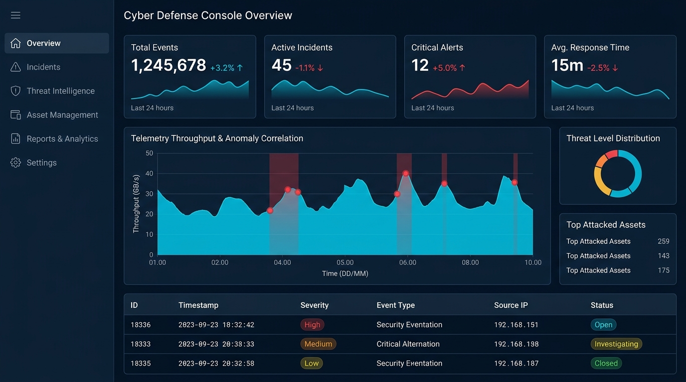
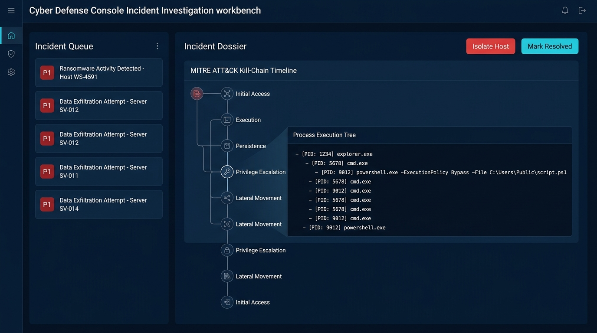
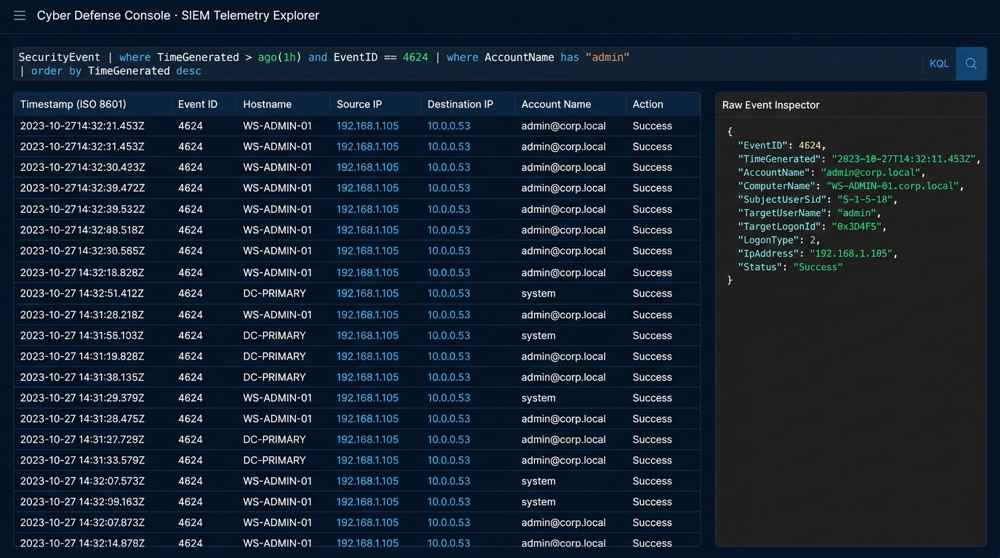

# Cyber Defense Console

A high-density SecOps and incident response console designed for security analysts, threat hunters, and SOC engineering teams managing real-time infrastructure telemetry and containment workflows.



---

## Core Screens & Capabilities

### 1. Overview & Triage
- **KPI Metric Cards**: Active P1 threats, live ingestion rate, protected endpoint counts, and mean time to contain with embedded SVG sparklines and tabular figures.
- **Telemetry Throughput & Anomaly Correlation**: Interactive multi-series chart across `15m`, `1h`, `24h`, and `7d` time windows.
- **MITRE ATT&CK Phase Filtering**: Filter the priority incident queue directly by kill-chain phase (`Initial Access`, `Execution`, `Persistence`, `Credential Access`, `Exfiltration`).
- **High-Risk Endpoint Watchlist**: Immediate host isolation and release controls synchronized across the console.

### 2. Incident Investigation Workbench


- **Attack Kill-Chain Timeline**: Vertical phase-coded timeline connecting correlated EDR, SIEM, IAM, Firewall, and Kubernetes Audit events.
- **Collapsible Process Execution Tree**: Inspect parent/child PIDs, execution paths, users, command lines, and copyable SHA-256 hashes.
- **Tactical Containment Controls**: One-click **Isolate Host**, **Revoke Token**, **Block IOC**, and **Mark Resolved** actions.
- **Analyst Investigation Log**: Append timestamped triage notes directly to an incident dossier.

### 3. Telemetry & SIEM Explorer


- **KQL / Lucene Query Bar**: Syntax-highlighted search supporting `host:`, `severity:`, `source:`, `ip:`, `mitre:`, `AND`, and `OR` operators with one-click hunt presets.
- **Live Event Stream**: Pause or resume live telemetry ingestion, toggle between **32px Compact** and **28px Ultra-Dense** row heights, and export filtered logs to CSV.
- **Quick-Pivot & JSON Inspector**: Click any hostname or IPv4 address to pivot into filtered logs or isolate the host, and inspect normalized JSON payloads side-by-side.

### 4. Asset & Agent Fleet + Threat Intel & Rules
- **Endpoint & Workload Inventory**: Filter by OS family (`Kubernetes`, `Linux`, `Windows`, `macOS`), inspect CPU/memory pressure and open CVEs (with CVSS scores), and run on-demand triage scans.
- **IOC Watchlist & Detection Rules**: Manage SHA-256, IPv4, Domain, and URL indicators with TLP classification, ingest new IOCs via modal, toggle SIEM detection rules, and launch rules straight into Telemetry Hunt.
- **Command Palette (`Cmd+K` / `Ctrl+K`)**: Jump instantly between views, open incidents, or pivot to any managed host.

---

## Quick Start

For full environment, build, and deployment instructions, see **[docs/SETUP.md](./docs/SETUP.md)**.

```bash
# 1. Clone the repository
git clone https://github.com/<your-org>/cyber-defense-console.git
cd cyber-defense-console

# 2. Install dependencies
npm install

# 3. Configure environment variables (optional for static preview)
cp .env.example .env

# 4. Start the development server on port 3000
npm run dev
```

Open `http://localhost:3000` in your browser.

---

## Tech Stack

- **Framework**: React 19 + TypeScript
- **Build Tool**: Vite 8
- **Styling**: Tailwind CSS v4 (`Plus Jakarta Sans` + `JetBrains Mono`)
- **Icons**: Lucide React

---

## Project Structure

```text
.
├── docs/
│   ├── SETUP.md                 # Detailed installation & deployment guide
│   └── images/                  # Console preview images for documentation
├── src/
│   ├── components/
│   │   ├── ui/Primitives.tsx    # StatusBadge, MitreTag, Sparkline, MetricCard, CopyButton
│   │   ├── OverviewScreen.tsx
│   │   ├── InvestigationScreen.tsx
│   │   ├── TelemetryScreen.tsx
│   │   ├── AssetsScreen.tsx
│   │   ├── ThreatIntelScreen.tsx
│   │   └── CommandPalette.tsx
│   ├── data/socData.ts          # Structured SecOps incidents, SIEM events, fleet & IOCs
│   ├── types/soc.ts             # TypeScript domain definitions
│   ├── App.tsx                  # Console shell, navigation, state synchronization
│   ├── index.css                # Tailwind v4 theme tokens & dark console styling
│   └── main.tsx
├── index.html
├── package.json
└── vite.config.ts
```
